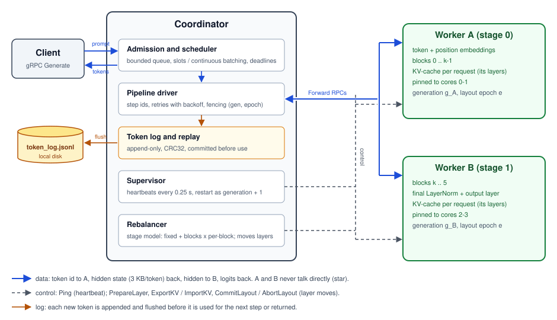
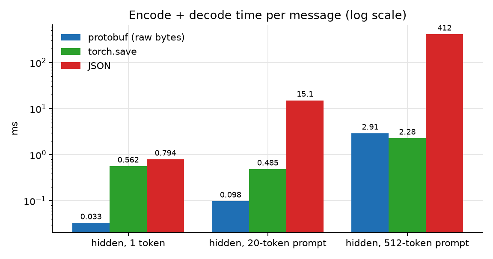
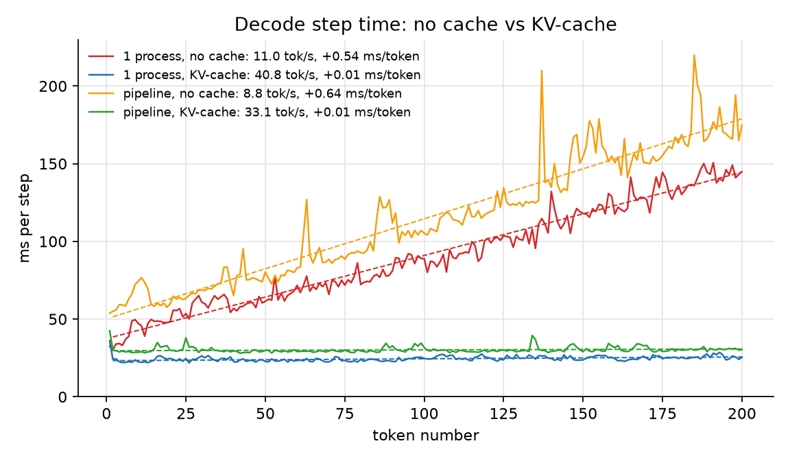
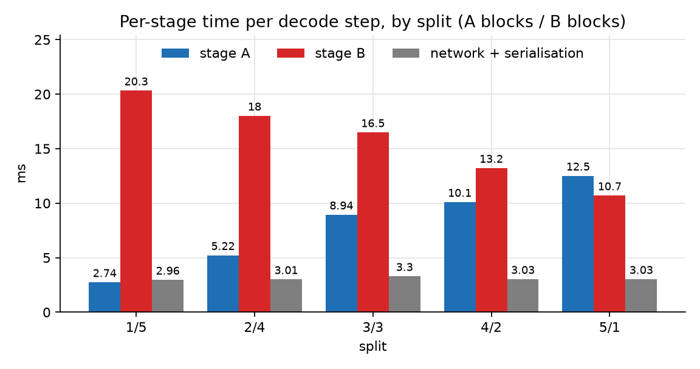
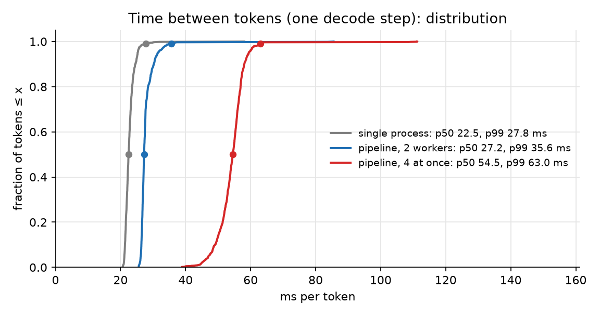
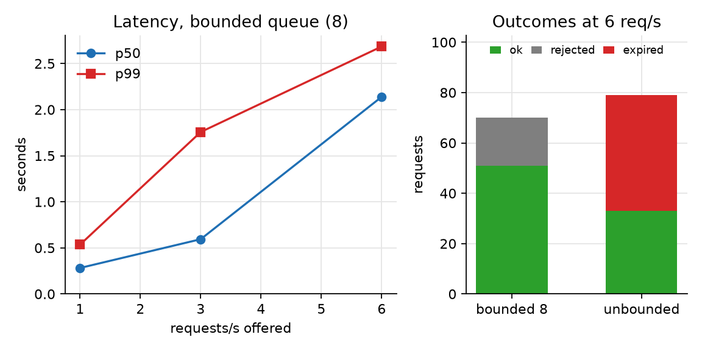
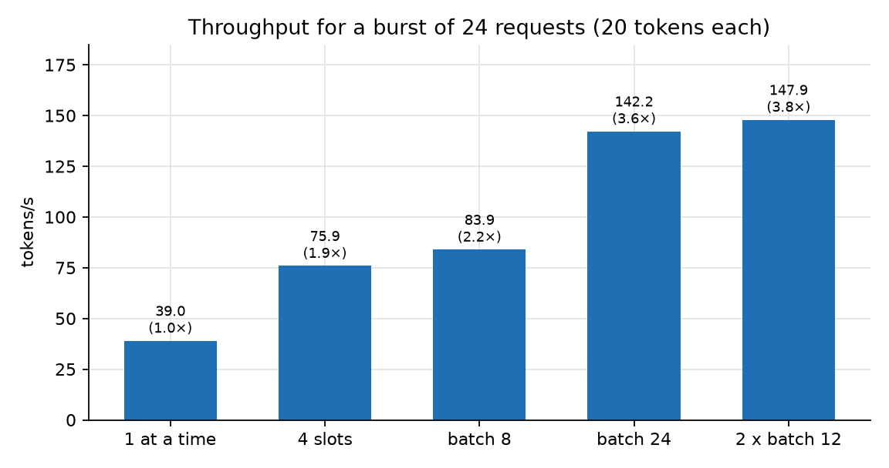
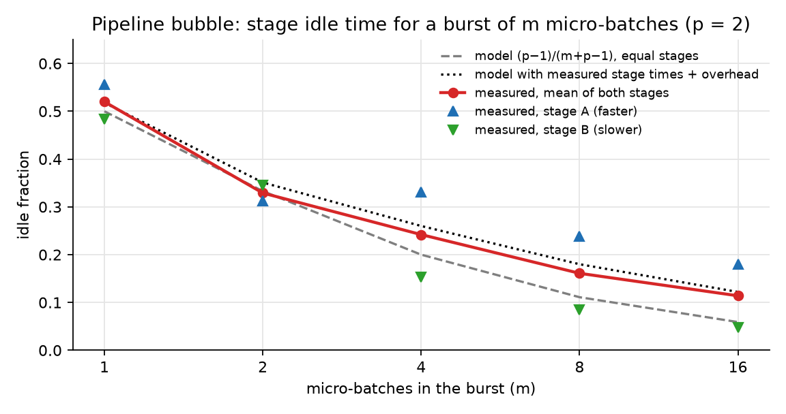
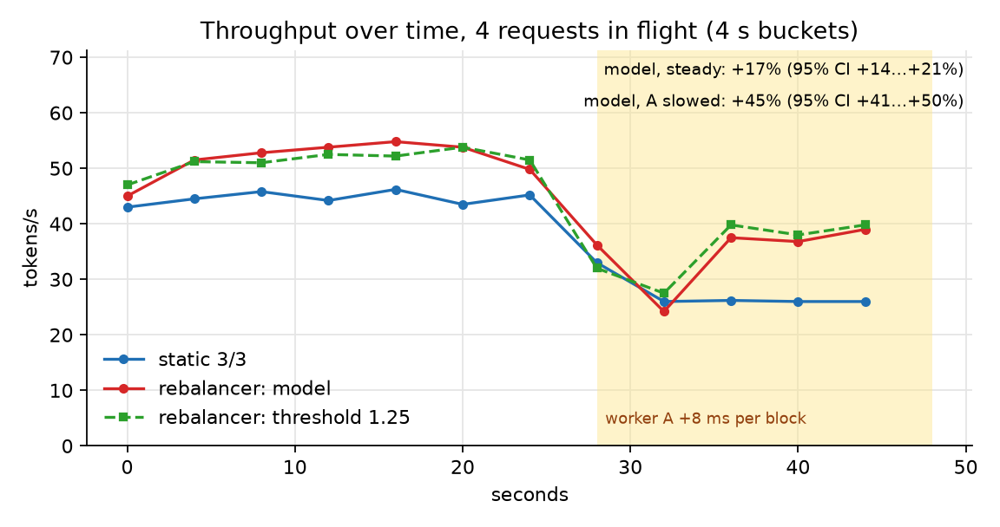
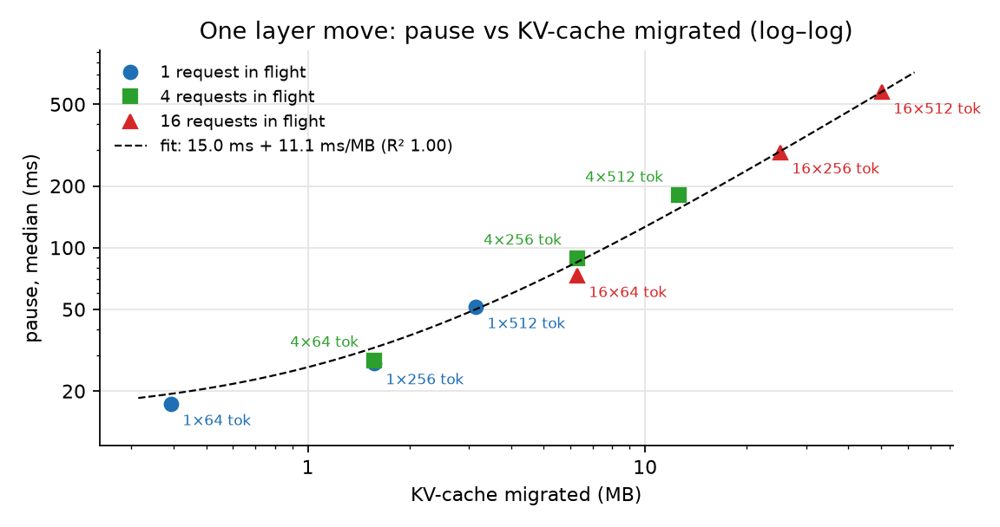

# Log-Structured Distributed LLM Inference Engine with Dynamic Stage Rebalancing

**Final Report: Distributed Systems, Monsoon 2026, Project 55**
Sunil Kumar, Roll No. 2025201099 
Code: https://github.com/Suniljadaun/distributed-gpt2-inference

---

## 1. Introduction

A large language model is often split across several machines, either because it does not fit on one, or to
spread the work. Splitting turns one program into a distributed system. Activations must cross the network for every
generated token, any worker can crash mid-request, and the parts can run at different speeds. The slowest one then
sets the speed of the whole pipeline.

This project builds an inference engine for GPT-2 (distilgpt2, 6 transformer blocks) from scratch in PyTorch,
split layer-wise across two worker processes that exchange tensors over gRPC. A coordinator admits requests through a
bounded queue, drives token-by-token generation with a distributed KV-cache, and appends every committed token to an
**append-only log**. When a worker crashes, it is restarted and its cache is rebuilt by **replaying the log**. Stale
replies are **fenced** off by generation numbers and step ids. When one stage becomes slower, the coordinator
**rebalances**: it moves boundary layers between workers, with their KV-cache slices, under a new epoch, without
stopping service.

**Headline results** (one 12-thread laptop, CPU only):
- Output is **token-for-token identical** to single-process inference in every configuration: cache, batching,
  after a worker crash, and across layer moves.
- KV-cache: **11.0 → 40.8 tokens/s** for 200-token generations in one process (3.7×), **8.8 → 33.1** through the
  pipeline (3.8×).
- Continuous batching: **39.0 → 147.9 tokens/s** (3.8×) with identical outputs.
- Worker crash: detected in **0.25 s**, restarted in **2.6 s**. The interrupted request completes with **identical
  output**; replaying 100 tokens takes **95 ms** vs 2.7 s to regenerate.
- Dynamic rebalancing vs a static even split: **+17%** at steady state and **+45%** when one worker is slowed
  down.

## 2. Goals and status

| Goal (from the scope report) | Status | Evidence |
|---|---|---|
| G1 Output identical to single-process inference | Done | `test_ch08.py` and every end-to-end test; `reference` experiment: 3/3 |
| G2 Distributed KV-cache, ordering by step ids | Done | `src/worker/server.py` (`RequestState`); `test_ch09.py`; `kv_cache` experiment |
| G3 Bounded queue, timeouts, retries with backoff | Done | `src/coordinator/scheduler.py`, `pipeline.py`; `test_ch10.py`; `load` experiment |
| G4 Micro-batching, pipeline bubble | Done (continuous batching); stage idle time measured against the bubble model | `ForwardBatch`, `BatchingScheduler`; `test_ch11.py`; `throughput` and `bubble` experiments |
| G5 Log-based crash recovery with fencing | Done | `supervisor.py`, `token_log.py`, `replay.py`; `test_ch12–14.py`; `recovery` experiment |
| G6 Dynamic stage rebalancing | Done; the epoch is fenced on every call and recorded in the token log; the scope's imbalance-threshold trigger is implemented and measured against the model (§5.6) | `rebalancer.py`, layout RPCs; `test_ch15.py`; `rebalance` experiment |

105 automated tests, run on every push by GitHub Actions. Instructions to run the engine, the tests, the benchmark
and the demo are in the repository's README.

## 3. Architecture

*Figure 1. System architecture. Star topology: for every decode step the coordinator calls worker A, then worker B.
The boundary k between the stages is changed at run time by the rebalancer (k = 3 at start).*

**Life of one token.** The scheduler picks a request (or a batch). The coordinator sends the last token id with
`step_id`, `start_pos`, the worker's expected `generation` and the layout `epoch` to A. A embeds it, runs its blocks
using that request's KV-cache, and returns the hidden state (3,072 bytes). The coordinator forwards it to B, which runs
its blocks, the final LayerNorm and the tied output layer, and returns logits. The coordinator picks the next token
(greedy), **appends it to the log and flushes**, and only then uses it for the next step or returns it to the client.

## 4. Design

### 4.1 Model and partitioning (G1)
GPT-2 is implemented by hand (attention, MLP, LayerNorm, blocks) and loads the pretrained distilgpt2 weights from
safetensors. Each worker reads **only its own tensors**. A stage is a contiguous range of blocks; the first stage also
owns the embeddings, the last the final LayerNorm and output layer. Tensors travel as protobuf messages with shape,
dtype and raw bytes. The protobuf overhead is 11–16 bytes; JSON was 5× larger and up to 100× slower to encode
(`wire` experiment, Figure 2). Correctness is checked against a stored single-process reference with greedy
decoding, so outputs must match exactly.

*Figure 2. Encode + decode time of one activation message in three formats (log scale). Raw bytes in protobuf is
the cheapest for the per-token messages that dominate decoding.*

### 4.2 Distributed KV-cache and step ordering (G2)
Each worker keeps keys/values for its own layers, per request. Every `Forward` carries `step_id` and `start_pos`. A
worker accepts only the next step. An exact duplicate of the last step (a retried RPC) returns the stored reply
instead of appending K/V twice. `Release` frees a finished request's cache. *Rejected alternative:* a central cache at
the coordinator, which would ship 36 KB per token per request across the network.

### 4.3 Admission, deadlines, retries (G3)
Requests enter a **bounded queue**. When it is full the client gets `RESOURCE_EXHAUSTED` immediately. Each request's
deadline is propagated, so each worker call gets only the remaining time. Failed calls are retried with exponential
backoff and full jitter, never past the deadline. *Rejected alternative:* an unbounded queue. Under overload every
request waits until it expires (see §5.3).

### 4.4 Batching (G4)
With one request in flight, A and B alternate and each idles half the time (the pipeline bubble). Several requests in
flight (slots) fill the bubble. **Continuous batching** (`ForwardBatch`) goes further: each decode step processes up to
B requests in one matrix multiply, and requests join and leave the batch at every step. Two batch groups keep both
stages busy. Worker threads are pinned (`--threads`) to avoid CPU oversubscription.

### 4.5 Failure detection and restart (G5)
A supervisor starts the workers as processes and pings them (`Ping`, every 0.25 s). A worker is declared dead when
its process exits or after 3 missed heartbeats (a hang). It is restarted with **generation + 1**. gRPC channels use
fast-reconnect options so the coordinator notices the new process quickly.

Before a replay, the coordinator checks the worker processes itself rather than waiting for the next heartbeat, and
waits until its *own* connections to the workers are ready. "The supervisor sees the worker" and "my connection
works" are different facts; without both checks a replay could be wasted on a dead or reconnecting worker, and with
a limit of 3 replays a request could be lost under load.

### 4.6 Append-only token log and replay (G5)
Every committed token is one line in an append-only file: a JSON record (request id, step, token, LSN) and its CRC32.
It is **flushed before the token is used** (write-ahead). After a worker restart the new process has an empty cache.
The coordinator rebuilds it by sending `prompt + committed tokens[:-1]` as **one prefill**, then continues. Each attempt
uses a fresh worker-side request id, so state from a dead attempt cannot mix in. On startup a CRC failure in the
**last** line is treated as a torn write and truncated; one in the **middle** is corruption and the log refuses to
open. *Choice:* flush (10.7 µs/token) rather than fsync (0.89 ms/token). The threat model is a process crash, not
power loss. Each token record also carries the **layout epoch** it was computed under, and every committed layout is a
`layout` record (epoch and layer range of each stage). The log therefore says which layout produced every token, and
a restarted coordinator starts its workers in the last logged layout instead of the default 3/3 split.

### 4.7 Fencing and idempotency (G5)
A worker declared dead may still be alive (a hang) and reply later: a *zombie*. Every request carries the expected
`generation`; replies from any other generation are rejected (`StaleReply`). A retried step is recognised by its step
id and a CRC32 digest of its input. Same digest: the stored reply is returned. Different digest: the request is
rejected (`ALREADY_EXISTS`) instead of silently computing a different answer. At the coordinator, concurrent
duplicates of a request id are **coalesced** into one computation, and a retry after completion is answered from the
log. The result is at-least-once delivery with idempotent processing, i.e. effectively-once.

### 4.8 Dynamic stage rebalancing (G6)
**Monitoring.** Every reply reports the time the worker spent in its blocks. The rebalancer fits, per stage,
`stage_time = fixed + blocks × per_block` over a sliding window. For each possible single-layer move at the boundary it
**predicts** the new bottleneck stage time. It moves only if the predicted drop exceeds 5%, then waits for a cooldown.
With **hysteresis**, a move that undoes the previous one needs a 10% predicted drop. Without it, two nearly equal
layouts (4/2 and 5/1, within ~1 ms) made the rebalancer move a layer back and forth: each move was correctly
predicted, but each gain was within the noise.

**Protocol.** (1) `PrepareLayer`: the receiver loads the layer's weights *while traffic continues*. (2) The layout
gate, a readers-writer lock with writer priority, pauses new steps. (3) `ExportKV` / `ImportKV` copy the layer's
KV-cache slices for all active requests. (4) `CommitLayout` on the **receiver first**, then the sender, with epoch + 1.
(5) Write the new layout to the token log, still inside the gate, so it precedes every token of the new epoch.
(6) Release the gate. Any failure before the receiver commits leads to `AbortLayout`, and the old layout stays.
After it, the sender's commit is retried, and steps carrying the old epoch are fenced. Measured pause: 7–34 ms in
the rebalancing runs; it grows with the KV-cache that has to move, about 11 ms per MB (§5.6).

**Rejected designs** (all implemented and measured):
- *Imbalance threshold* (the rule in the scope report: move a layer off the slower stage when slow/fast > 1.25). It is
  still available (`policy="threshold"`) and is compared with the model in §5.6. It reaches a similar throughput but
  never settles: B's output layer is a fixed cost that does not move with layers, so the 4/2 and 5/1 splits both
  look imbalanced, and it moves a layer back and forth between them.
- *Workers sharing all CPU cores:* no gain, since moving work to B slowed B down by the same amount. Rebalancing only
  helps with separate resources, so workers are pinned to their own cores (`--cpus`).
- *Concurrent requests inside a stage:* stage times became too noisy to act on (15 flapping moves). Stages process one
  step at a time (`--serial`).

### 4.9 Deployment: one container per process
The engine also runs under Docker Compose as three containers (worker A, worker B, coordinator) from one image that
contains the model, each container limited to 2 CPUs. Here the coordinator does not own the worker processes:
Docker's restart policy restarts a crashed container, by re-running the *same* command. Two changes make the
failure handling of §4.5–4.7 work in that setting:
- **Generation from the start time.** A worker started with `--generation 0` uses its start time in milliseconds, so
  every restart is a new, larger generation even though the command is identical, and fencing still works.
- **Health by observation.** Instead of the supervisor, a `RemoteHealth` monitor pings the workers over the Compose
  network. It marks a worker down after missed pings, recognises a restarted one by its new generation, moves the
  pipeline's fence to it, and then lets the replay of §4.6 run.

Measured from the host: the reference prompts match token for token across containers, and killing the worker
process inside the `worker-b` container (`kill -9`) in the middle of a 100-token request is recovered by Docker's
restart and one replay. The request took 7–8 s instead of ~3 s, and the output was identical to single-process
inference. Lost requests: 0. GitHub Actions repeats this check on every push.

The rebalancer is not enabled in this deployment: Docker restarts a worker with its original command, so after a
layer move a restarted container would come back with the old layer range. Rebalancing (§4.8, §5.6) runs with the
supervisor, which restarts a worker with its current range.

## 5. Evaluation

**Setup.** AMD Ryzen laptop (AMD64 Family 23 Model 104, 12 logical CPUs), Windows 11, Python 3.14.7, PyTorch 2.14.1
CPU, gRPC 1.84.0, distilgpt2, greedy decoding, all processes on localhost. All numbers are from one benchmark run
(commit `a2035fc`); the raw data, with the environment it ran in, is in `results/bench/`. Charts are drawn with
Matplotlib; fits and confidence intervals are computed with NumPy.

### 5.1 Correctness
3 of 3 reference prompts reproduced token for token by 2 workers. Every throughput configuration, the crash
experiment, and all rebalancing runs also compare their outputs with the reference: **0 differing tokens**.

### 5.2 KV-cache and the split point
| | tokens/s (200 tokens) | step 2 | step 200 | growth per token | A → B, last step |
|---|---|---|---|---|---|
| 1 process, no cache | 11.0 | 30.4 ms | 144.8 ms | +0.54 ms (R² 0.97) | – |
| 1 process, KV-cache | 40.8 | 24.0 ms | 25.4 ms | +0.01 ms (R² 0.25) | – |
| pipeline, no cache | 8.8 | 55.0 ms | 174.8 ms | +0.64 ms (R² 0.91) | 627 KB |
| pipeline, KV-cache | 33.1 | 29.9 ms | 30.4 ms | +0.005 ms (R² 0.03) | 3 KB |

The pipeline without a cache is the engine's first distributed version: every step sends the whole sequence through
both workers (here: a fresh request at every step, its cache dropped afterwards). During the build it measured
~49 ms per step on short sequences; here it starts at 50–55 ms. The cache helps the pipeline as much as one process,
3.8× (8.8 → 33.1 tokens/s) vs 3.7×. Without it, splitting the model also costs more as the text grows. The gap to one
process widens from ~25 ms to ~30 ms per step over 200 tokens (+0.64 vs +0.54 ms per token), because A ships the
hidden state of *every* position to B: 627 KB on the last step instead of 3 KB.

| split (A/B blocks) | A ms | B ms | overhead ms | step ms |
|---|---|---|---|---|
| 1/5 | 2.74 | 20.32 | 2.96 | 26.11 |
| 2/4 | 5.22 | 18.01 | 3.01 | 26.35 |
| 3/3 | 8.94 | 16.49 | 3.30 | 28.43 |
| 4/2 | 10.10 | 13.22 | 3.03 | 26.27 |
| 5/1 | 12.51 | 10.70 | 3.03 | 26.34 |

With one request the step time is the *sum* of the stages, so the split barely matters (26–28 ms). The split
matters when stages overlap (§5.6). B is always heavier than its block count suggests: it owns the output layer
(768 × 50,257). Network + serialisation overhead is ~3 ms per step for two hops.

The growth column is a least-squares line through the step times (from step 2; step 1 is the prefill). It makes the
KV-cache claim a single number: without the cache every generated token makes the next step **0.54 ms slower**
(R² 0.97). With the cache the slope is **0.01 ms per token**, i.e. flat (the low R² means what remains is noise).

*Figure 3. Time per decode step over a 200-token generation, in one process and through the pipeline, with and
without the KV-cache; dashed: least-squares fits.*

*Figure 4. Stage times for each split point (one request at a time).*

**Per-token latency.** The same answers (the 3 reference prompts in turn, 10 runs of 60 tokens after one warm-up) were generated
in a single process and through the pipeline. Time to first token is the prefill step; the time between tokens is
one decode step. Pipeline times are measured by the coordinator around the whole step, both hops included.

| | first token p50 | first token p99 | between tokens p50 | between tokens p99 | tokens/s per request |
|---|---|---|---|---|---|
| single process | 32.1 ms | 46.9 ms | 22.5 ms | 27.8 ms | 43.8 |
| pipeline, 2 workers | 37.8 ms | 50.0 ms | 27.2 ms | 35.6 ms | 35.7 |
| pipeline, 4 requests at once | 123.5 ms | 136.4 ms | 54.5 ms | 63.0 ms | 18.4 (×4 = 73.6) |

Splitting the model costs **4.8 ms per token at p50 and 7.8 ms at p99** (+21% and +28%): two gRPC hops,
serialisation and the extra Python work, the ~3 ms overhead of Figure 4 plus its variation. The p99 values of the
first token come from only 10 (or 20) prefills each, so they are close to the maximum. The distribution is narrow in
both cases: p99 is within 9 ms of p50, so no token is held up by retries or long pauses when nothing fails. With
four requests at once, each request waits for the others at every stage, and its time between tokens doubles. But
four are served together, so the pipeline delivers 73.6 tokens/s in total, twice its one-request rate. That is the
latency/throughput trade-off that batching (§5.4) takes further.

*Figure 5. Distribution of the time between tokens; dots mark p50 and p99.*

### 5.3 Backpressure (G3)
| queue | arrival rate (req/s) | sent | ok | rejected | expired | p99 (s) | L sampled | L = λW |
|---|---|---|---|---|---|---|---|---|
| bounded 8 | 1 | 15 | 15 | 0 | 0 | 0.54 | 0.34 | 0.34 |
| bounded 8 | 3 | 32 | 32 | 0 | 0 | 1.76 | 1.92 | 1.93 |
| bounded 8 | 6 | 70 | 51 | 19 | 0 | 2.69 | 6.98 | 6.99 |
| unbounded | 6 | 79 | 33 | 0 | 46 | 3.01 | 14.17 | 14.18 |

Above capacity, the bounded queue rejects 19 requests immediately and completes 51. The unbounded queue accepts all
of them and lets 46 of 79 expire after waiting: fewer completions (33) and twice the queue length. Little's Law
(sampled L vs λ·W) holds within 2%.

*Figure 6. Left: latency of the bounded queue as the offered rate grows. Right: what happened to the requests at
6 req/s, bounded vs unbounded queue.*

### 5.4 Batching (G4)
| configuration | tokens/s | mean latency (s) | outputs = reference |
|---|---|---|---|
| 1 at a time | 39.0 | 6.39 | yes |
| 4 slots | 75.9 | 3.68 | yes |
| batch 8 | 83.9 | 3.81 | yes |
| batch 24 | 142.2 | 3.34 | yes |
| 2 groups × batch 12 | 147.9 | 3.21 | yes |

Throughput rises 3.8× and latency *falls*: requests no longer wait for each other to finish. Two groups beat one
batch of 24 by filling the pipeline bubble.

*Figure 7. Throughput for each batching configuration (speed-up over one at a time in brackets); every output
matched the reference.*

**Pipeline bubble.** To compare with the bubble model directly, m independent micro-batches (32-token prefills) are
sent through the pipeline at once, with each worker processing one step at a time on cores of its own. The idle
fraction of a stage is 1 − (time it spent computing) / (time from the first send to the last reply); medians of
5 bursts:

| m | stage A idle | stage B idle | measured (mean) | model (p−1)/(m+p−1) | model with measured stage times |
|---|---|---|---|---|---|
| 1 | 0.56 | 0.48 | 0.52 | 0.50 | 0.52 |
| 2 | 0.31 | 0.35 | 0.33 | 0.33 | 0.35 |
| 4 | 0.33 | 0.15 | 0.24 | 0.20 | 0.26 |
| 8 | 0.24 | 0.08 | 0.16 | 0.11 | 0.18 |
| 16 | 0.18 | 0.05 | 0.11 | 0.06 | 0.12 |

For m = 1 and 2 the measurement matches the formula. For larger bursts the idle time falls more slowly than the
formula predicts, and almost all of the difference is stage A: B is the slower stage (≈ 77 vs 64 ms per item), so
once the bubble is small, A waits for B in every step. The formula assumes equal stages; the same reasoning with the
measured stage times and the ≈ 4 ms per-step overhead (fill + drain, then one item per bottleneck-stage time)
predicts the measurement within 0.02 at every m. The pipeline bubble shrinks as the model says, and what remains is
imbalance between the stages, which is the problem rebalancing (§5.6) addresses.

*Figure 8. Idle fraction for a burst of m micro-batches: measured per stage and on average, the textbook model,
and the model with the measured stage times.*

### 5.5 Recovery (G5)
| heartbeat | crash detect | restart | hang detect | 100-token request | same, worker B killed | replays | identical |
|---|---|---|---|---|---|---|---|
| 0.25 s | 0.25 s | 2.57 s | 1.57 s | 3.19 s | 5.99 s | 1 | yes |

| tokens to recover | replay | regenerate |
|---|---|---|
| 25 | 58.7 ms | 677 ms |
| 100 | 95.2 ms | 2,708 ms |
| 400 | 311.6 ms | 10,831 ms |

A crash costs the request ~2.8 s, almost all of it the restart (process start + weight load). Replay itself is
11–35× faster than regenerating, because it is one batched prefill rather than N sequential steps.

### 5.6 Rebalancing (G6)
Each worker on its own cores, 4 requests in flight, 48 s run, throughput measured in 4 s buckets. At t ≈ 29 s worker
A is slowed by 8 ms per block.

| period | static 3/3 (tok/s) | model policy (tok/s) | gain (95% CI) | layout |
|---|---|---|---|---|
| steady (t = 4–24 s, 6 buckets) | 44.9 | 52.8 | +17% (+14 … +21%) | 4/2 |
| A slowed (t = 36–44 s, 3 buckets) | 26.1 | 37.8 | +45% (+41 … +50%) | 2/4, then 1/5 |

The intervals (bootstrap over the 4 s buckets) cover variation within this run only; across separate runs the gains
were +7 to +19% (steady) and +31 to +45% (slowed).

The rebalancer moved one layer to A at start-up (B carries the output layer), then three layers to B after the
slowdown, one per cooldown. Each predicted bottleneck time was confirmed by the next measurement within ~1 ms
(e.g. predicted 35.1 ms, measured 36.0 ms; predicted 23.8 ms, measured 24.3 ms). When the slowdown is removed, the
layers move back to the original 4/2 layout and throughput recovers.

**Model vs imbalance threshold.** The same run with the scope report's rule (move a layer off the slower stage when
it takes more than 1.25× as long as its neighbour), measured right after the other two:

| | steady: gain vs static | steady: moves | A slowed: gain vs static | A slowed: moves | final layout |
|---|---|---|---|---|---|
| model policy | +17% (+14 … +21%) | 1 | +45% (+41 … +50%) | 3 | 1/5 |
| threshold 1.25 | +16% (+13 … +19%) | 7 | +50% (+46 … +53%) | 2 | 2/4 |

In throughput the two are close, so the claim is not that the threshold is slower. The difference is stability. With
B's fixed output-layer cost, 4/2 (A 13.6, B 16.9 ms: ratio 1.24–1.27) and 5/1 (A 17.6, B 12.8 ms: ratio 1.37) are both
"imbalanced". The threshold rule moved layer 4 back and forth between them six times in about 22 s, pausing every request
for 9–28 ms each time. The model predicted that 5/1 would make A the bottleneck and did not move. After the
slowdown, the threshold rule stopped at 2/4, because 24.0 / 20.2 ms is below 1.25. The model made one more move, to
1/5, predicting a bottleneck of 23.2 instead of 24.5 ms; measured, B became the bottleneck at 24.0 ms, a 2% cut
rather than 5%, which is within the noise of the throughput figures.

*Figure 9. Throughput over time (4 s buckets): static 3/3 split, the model policy and the imbalance threshold.
Shaded: worker A slowed.*

**Cost of one layer move.** A move carries the moved layer's K and V for every request in flight: 2 × 768 float32
values = **6,144 bytes per cached token per request**. With R requests of L cached tokens each in flight, layer 2
was moved from A to B and back three times (six moves per configuration):

| requests × tokens | KV migrated | pause (median) | pause (max) | weights loaded, no pause |
|---|---|---|---|---|
| 1 × 64 | 0.39 MB | 17 ms | 33 ms | 96 ms |
| 1 × 512 | 3.1 MB | 51 ms | 64 ms | 80 ms |
| 4 × 256 | 6.3 MB | 89 ms | 121 ms | 86 ms |
| 16 × 64 | 6.3 MB | 73 ms | 90 ms | 84 ms |
| 4 × 512 | 12.6 MB | 180 ms | 204 ms | 71 ms |
| 16 × 512 | 50.3 MB | 572 ms | 838 ms | 70 ms |

The bytes migrated equalled R × L × 6,144 in all nine configurations. The pause, during which every request
waits, is a straight line in the bytes: **15 ms + 11.1 ms per MB** (least squares, R² 1.00), i.e. about 90 MB/s
through export, gRPC and import on one machine. It depends only on the bytes, not on how they are split: 4 × 256 and
16 × 64 tokens (both 6.3 MB) pause for about the same time. Loading the layer's weights (phase 1) takes 70–96 ms but
does not pause anything. The moves in the rebalancing runs (4 requests of at most 35 tokens, under 1 MB) paused for 7–34 ms. At 16 requests of 512 tokens
the pause reaches about 0.6 s, roughly 25 decode steps lost by every request in flight. At that size, sending the
slices before the pause and only the last few positions inside it would shorten the pause, and so would dropping a
request's slice and replaying it from the token log (§4.6).

*Figure 10. Pause of one layer move vs KV-cache migrated (log–log; labels are requests × cached tokens).*

### 5.7 Threats to validity
All processes share one laptop and talk over localhost, so network costs are far below a real cluster's.
CPU frequency scaling and background programs add run-to-run variation of roughly ±5%; only differences well
above that are claimed. The slowdown in §5.6 is injected (a fixed sleep per block), not a real co-located workload.

**Platform.** On Windows the split model's logits are bit-identical to the full model's; on Linux (CI) they differ
by up to 1.5 × 10⁻⁵ on logits of ≈ 70, i.e. float32 rounding. Stage B applies the output layer to the last row
only, the full model to every row, and Linux's matrix-multiply kernels round differently for different shapes.
Generated **tokens** are identical on both platforms, which is what G1 promises.

## 6. Conclusion

The engine implements all six goals of the scope report, and its outputs are identical to single-process inference
throughout. The main lessons:
- **Write-ahead logging turns worker state into a cache.** Losing it costs a replay (~0.1 s), not the request.
- **Fencing by generation and epoch** is what makes restarts and layer moves safe while old messages are still in flight.
- **Rebalancing works best with a model of what a move does.** A plain imbalance threshold gained as much
  throughput here, but kept moving a layer back and forth; predicting the bottleneck lets the rebalancer settle. Both
  need isolated resources and quiet measurements to work at all.

**Next steps.** The coordinator is still a single point of failure: its log is local, so the next step is to
replicate it (e.g. with Raft). Layer moves need workers that the coordinator starts itself: workers that outlive a
crashed coordinator (as in the Docker deployment) could be left at different epochs by an interrupted move, which a
new coordinator detects but does not repair. Token logging currently works with the slot scheduler only, not with continuous
batching. A layer move pauses all requests for about 11 ms per MB of KV-cache; with large caches the slices should
be copied before the pause. Beyond that: a chain topology (A → B directly, one hop less per step), and more workers and the larger
GPT-2, which the design supports but which were not measured.

